# UOL Lost & Found Board

An Android app in Java where students at The University of Lahore can post an item they lost or found on campus, and everyone sees every post on one shared board that updates by itself. All of the data lives in Firebase Realtime Database. I built it for Lab Task 03 (Firebase and RecyclerView) of Mobile Application Development (CS02310), Fall 2026, Section S.

Abu Huraira, SAP ID 70145777, Section S

<p>
  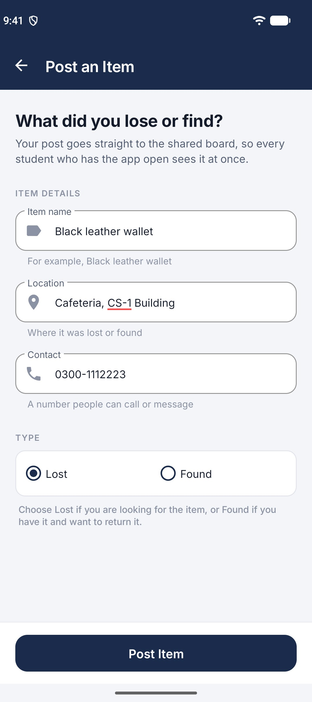
  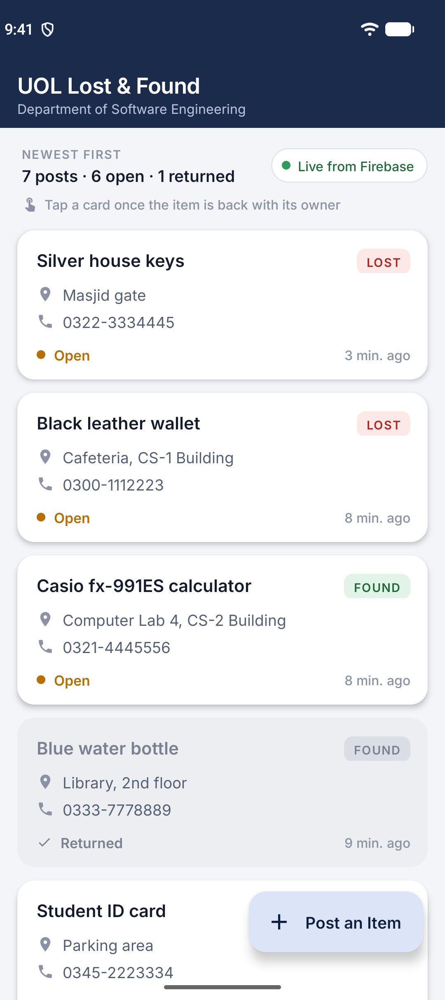
  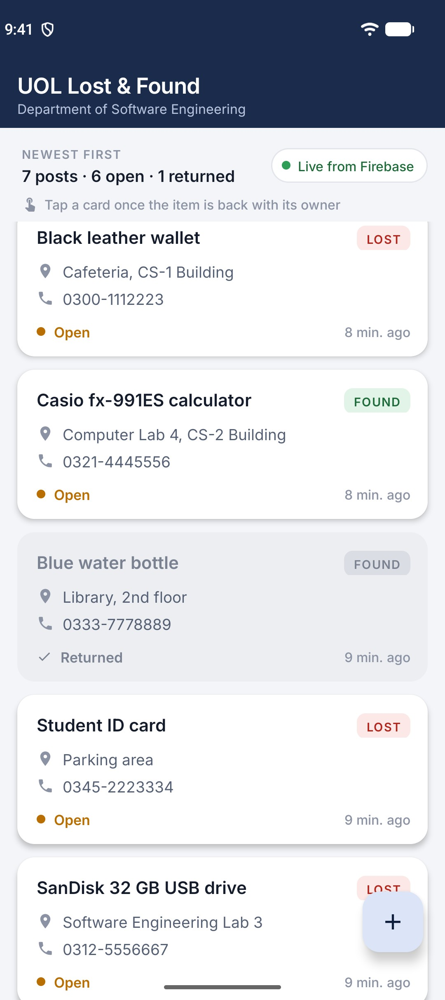
  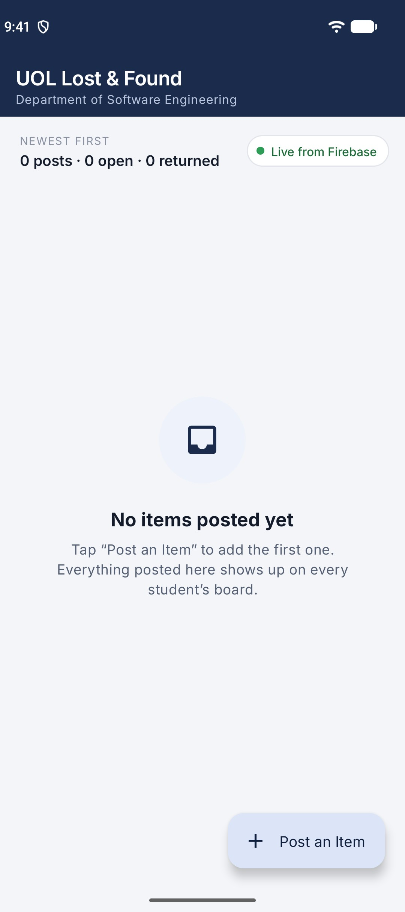
</p>

## Firebase project

| | |
|---|---|
| Firebase project | `uol-lost-and-found-70145777` |
| Database URL | https://uol-lost-and-found-70145777-default-rtdb.firebaseio.com |
| Database location | United States (us-central1), created in test mode |
| Node used by the app | `LostFound` |
| Android package | `com.example.uollostfound` |

`app/google-services.json` is listed in `.gitignore` from the first commit, so it is not in this repository (Lab 9 says it must not be shared publicly). To run the project, register an Android app with the package name above in your own Firebase project, download its `google-services.json` and put it in the `app/` folder.

## How the app is put together

| Part | File | What it does |
|---|---|---|
| Firebase setup | `build.gradle.kts`, `app/build.gradle.kts`, `gradle/libs.versions.toml` | google-services plugin 4.6.0 and `firebase-database` through Firebase BoM 34.18.0, plus recyclerview 1.3.2 and cardview 1.0.0 |
| Permission | `AndroidManifest.xml` | `android.permission.INTERNET`, and both activities declared |
| Model class | `LostItem.java` | One post. Private String fields `id`, `itemName`, `type`, `location`, `contact`, `status`, a no-argument constructor for Firebase, a full constructor, and a getter and setter for each field |
| Post screen | `PostItemActivity.java`, `activity_post_item.xml` | The form. Refuses empty fields with `setError()`, then writes the post with `push()` and `setValue()` |
| Card layout | `item_lost.xml` | A `CardView` root with `app:cardCornerRadius="16dp"` and `app:cardElevation="3dp"` showing the name, type, location, contact and status |
| Adapter | `LostItemAdapter.java` | Overrides `onCreateViewHolder`, `onBindViewHolder` and `getItemCount`, with a static inner `LostItemViewHolder` and the `OnItemClickListener` interface from Lab Task 2 |
| Board | `MainActivity.java`, `activity_main.xml` | Reads `LostFound` with `addValueEventListener()`, shows the newest post first, marks a tapped post as Returned and removes the listener in `onDestroy()` |

How one post reaches every board:

```
tap Post Item
  -> lostFoundRef.push().getKey()            new time-ordered key, also stored as the item's id
  -> lostFoundRef.child(key).setValue(item)  status "Open"
  -> onDataChange() on every phone that has the board open
  -> list cleared, refilled from snapshot.getChildren(), reversed
  -> adapter.notifyDataSetChanged()          the new card appears on top
```

## Scenario 1: posting an item

Tapping "Post an Item" on the board opens `PostItemActivity`. The form has fields for the item name, location and contact, and a `RadioGroup` for Lost or Found. If a field is empty, Post Item sets an error on it and moves the focus to the first empty field. The error disappears as soon as the student starts typing.

<p>
  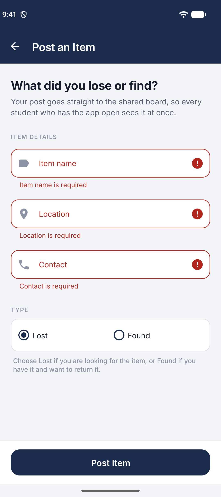
  
  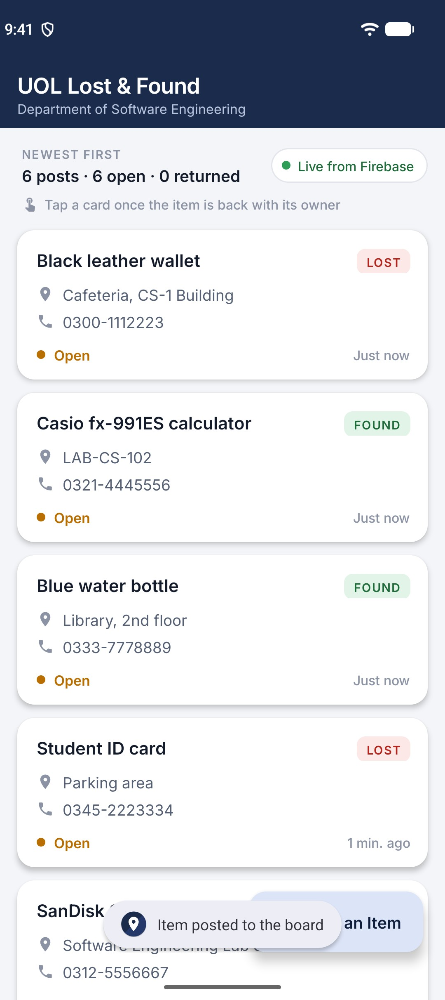
  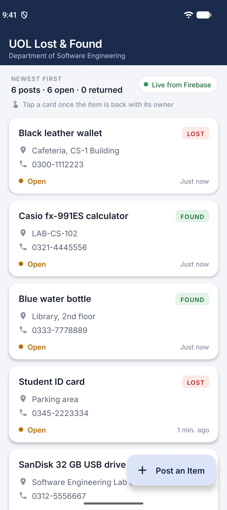
</p>

The write itself:

```java
String key = lostFoundRef.push().getKey();
LostItem item = new LostItem(key, name, type, location, contact, "Open");
lostFoundRef.child(key).setValue(item, (error, ref) -> {
    if (error == null) {
        Toast.makeText(this, R.string.toast_posted, Toast.LENGTH_SHORT).show();
        finish();
    } else {
        Toast.makeText(this, getString(R.string.toast_post_failed, error.getMessage()), Toast.LENGTH_LONG).show();
    }
});
```

I posted six items through the app (three Lost and three Found). This is the `LostFound` tree in the Firebase Console afterwards, with the newest post (the wallet) expanded:

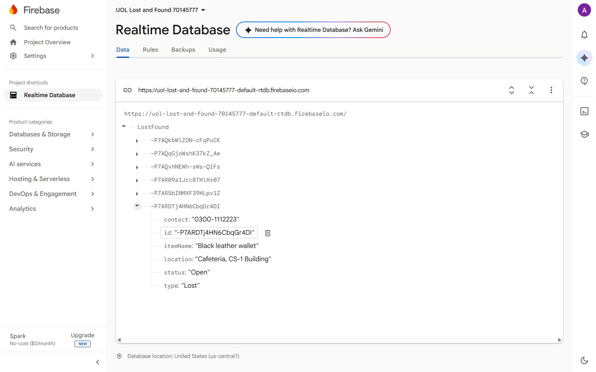

### Offline test

With the six posts on the board, I turned on airplane mode in the emulator and posted a seventh item, "Silver house keys".

<p>
  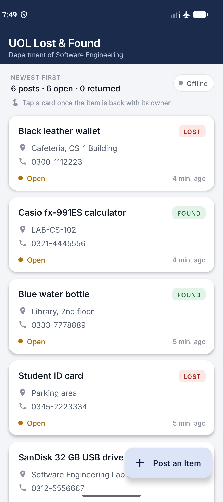
  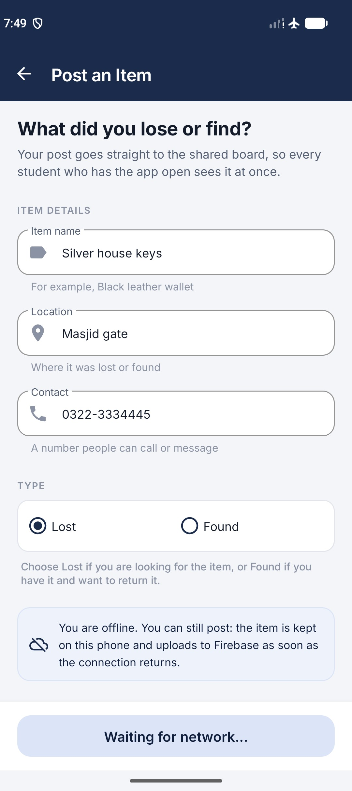
  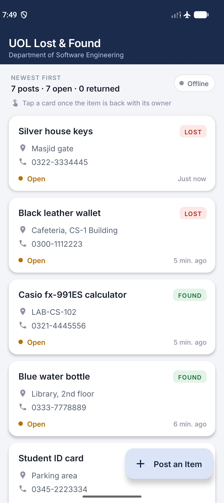
  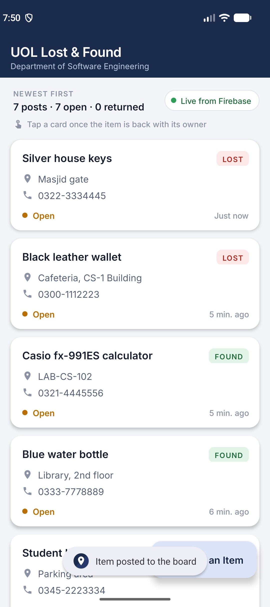
</p>

On the device, the form did not close and the button changed to "Waiting for network". When I went back to the board, the keys were already at the top and the count said 7 posts. The Console still showed only six children under `LostFound`. When I turned the network back on, the Console got the seventh key within a few seconds, and the "Item posted to the board" Toast appeared on the phone at that moment, not when I tapped the button.

<p>
  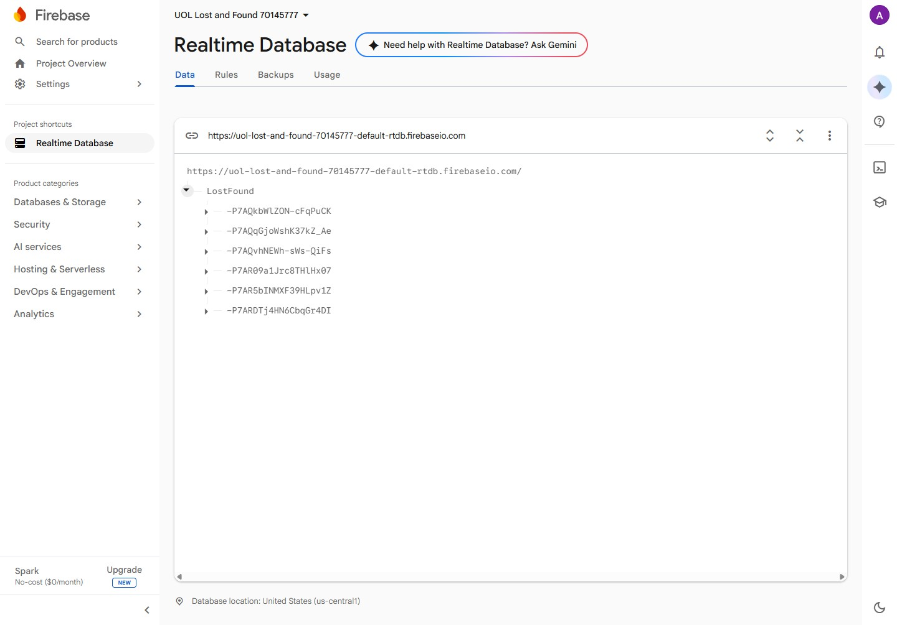
  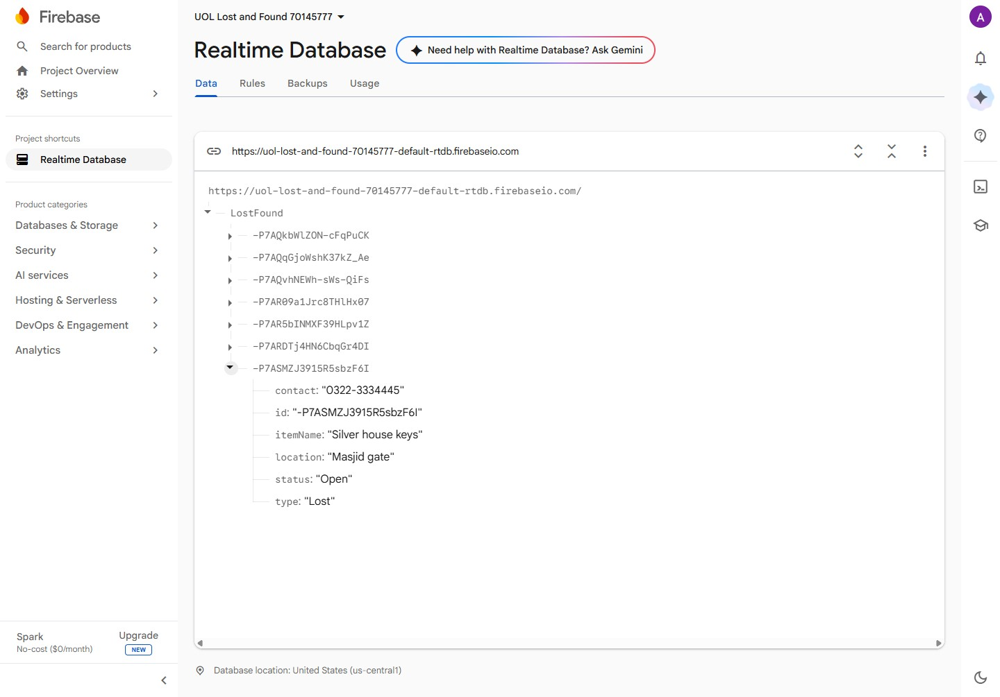
</p>

The reason is that the Firebase SDK keeps a local copy of the data it is listening to. `setValue()` first applies the write to that local copy, which fires `onDataChange()` straight away on the same phone, so the card shows up even without a connection. The write itself waits in a queue. The completion listener only runs once the server has accepted the write, so with no network it waits, and as soon as the connection comes back the SDK sends the queued write, the server stores it, and the completion listener shows the Toast. Without disk persistence this queue is kept in memory, so a write made offline is lost if the app process is killed before the network returns. I saw this happen once, when I reinstalled the app while a post was still waiting.

## Scenario 2: the live board

`MainActivity` attaches one `ValueEventListener` to `LostFound` and keeps it in a field:

```java
boardListener = new ValueEventListener() {
    @Override
    public void onDataChange(@NonNull DataSnapshot snapshot) {
        items.clear();
        for (DataSnapshot child : snapshot.getChildren()) {
            LostItem item = child.getValue(LostItem.class);
            if (item != null) items.add(item);
        }
        Collections.reverse(items);          // push keys are time-ordered: newest first
        adapter.notifyDataSetChanged();
        emptyState.setVisibility(snapshot.hasChildren() ? View.GONE : View.VISIBLE);
    }

    @Override
    public void onCancelled(@NonNull DatabaseError error) {
        Toast.makeText(MainActivity.this, getString(R.string.toast_read_failed, error.getMessage()), Toast.LENGTH_LONG).show();
    }
};
lostFoundRef.addValueEventListener(boardListener);
```

`onDestroy()` removes it with `lostFoundRef.removeEventListener(boardListener)`. When the node has no children, the board shows "No items posted yet" instead of an empty list.

Tapping a card marks the item as Returned. Only the `status` child of that post is written:

```java
lostFoundRef.child(item.getId()).child("status").setValue("Returned", ...);
```

A returned card turns flat and grey, its badge loses its colour, and the orange "Open" dot becomes a check mark with "Returned". A Snackbar confirms the change and offers Undo. Tapping a card that is already returned only shows a message and writes nothing.

<p>
  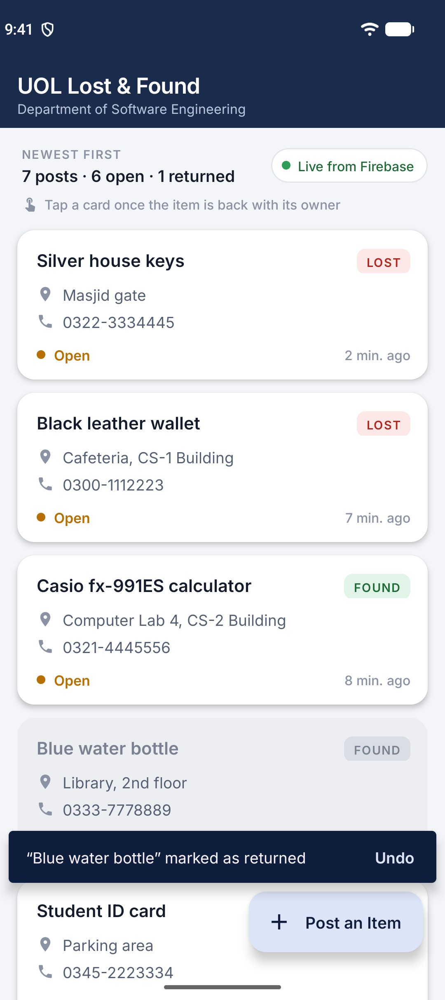
  
  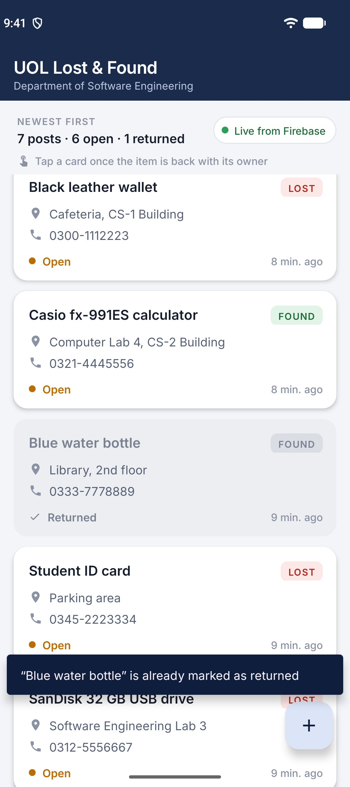
  
</p>

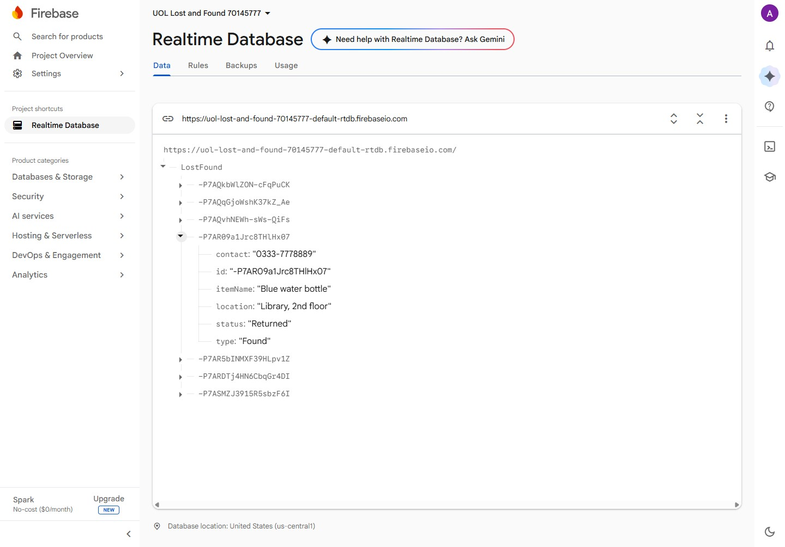

### Live test

I changed the location of the Casio calculator in the Firebase Console from `LAB-CS-102` to `Computer Lab 4, CS-2 Building`. The card on the phone changed by itself about two seconds later. I did not touch the phone, and the app has no refresh button.

<p>
  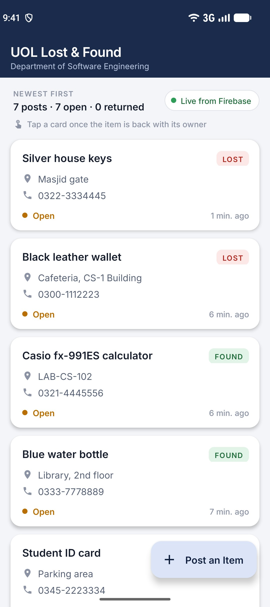
  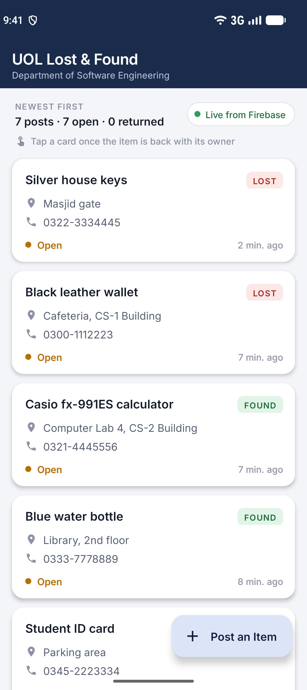
</p>

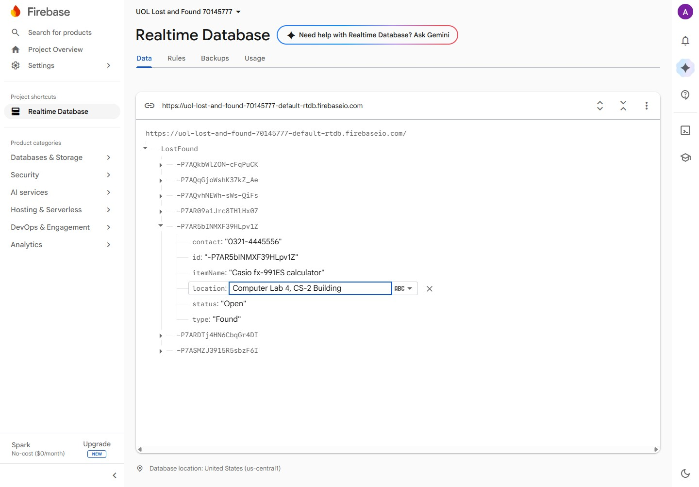

Why `addValueEventListener()` and not `addListenerForSingleValueEvent()`:

> `addListenerForSingleValueEvent()` reads `LostFound` once and then detaches, so the board would never see a post, an edit or a Returned status made after it opened.
> `addValueEventListener()` stays attached and calls `onDataChange()` again on every change, which is what keeps every student's board live without a refresh button.

## Design notes

The interface follows Material 3 with a navy and grey palette and the Inter typeface. Some of the choices:

- Each card shows the type as a coloured badge (red for Lost, green for Found) and the status as a dot or a check mark. Returned cards are not shown in colour alone, because the text and icon change as well.
- A header above the list shows the counts and a chip that says "Live from Firebase" or "Offline", driven by Firebase's `.info/connected` location.
- The Post Item button stays above the keyboard at the bottom of the screen. While a post is being saved, the form is locked so the same post cannot be sent twice.
- A short hint tells students that tapping a card marks the item as returned, and Undo lets them take back an accidental tap.
- TalkBack reads each card as one sentence that ends with what a double tap does, and every touch target is at least 48 dp.

## Running the project

1. Open the folder in Android Studio (Empty Views Activity template, Java, minimum SDK 24, target SDK 36).
2. Add your own `app/google-services.json` as described above, and create a Realtime Database in test mode.
3. Run the `app` configuration on an emulator or a phone with internet access.

## Project structure

```
app/src/main/
├── AndroidManifest.xml
├── java/com/example/uollostfound/
│   ├── LostItem.java
│   ├── LostItemAdapter.java
│   ├── MainActivity.java
│   └── PostItemActivity.java
└── res/
    ├── layout/   activity_main.xml, activity_post_item.xml, item_lost.xml
    ├── values/   colors.xml, strings.xml, themes.xml, dimens.xml
    ├── drawable/ vector icons and shapes
    └── font/     Inter
docs/screenshots/  every screenshot used in this README and in the report
```
